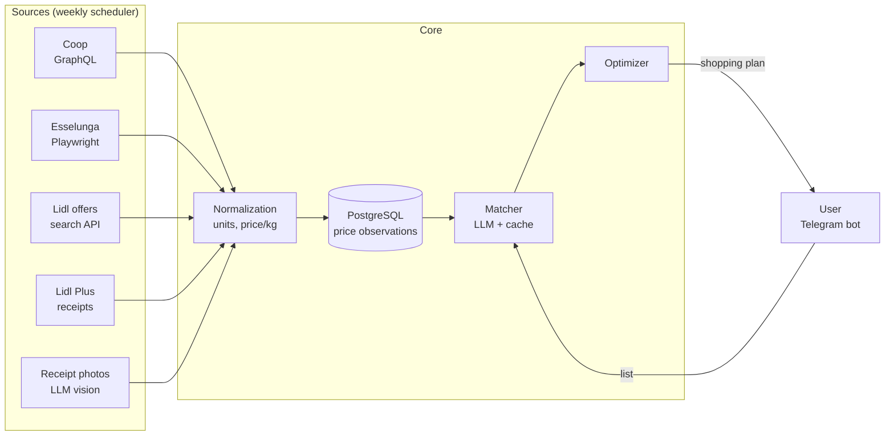

# 🛒 GroceRoute

> Tell me what you need to buy, I'll tell you where to buy it.

GroceRoute takes a **generic shopping list** ("tuna, passata, milk, detergent") and the **supermarkets you shop at**. It tells you **which store to buy what from**, based on real offers and prices. It only sends you to an extra store when the trip is worth it.

```
Esselunga (base store): passata, milk, bread, detergent
Lidl:                   tuna, olive oil, coffee      → you save €4.20
Conad skipped:          only yogurt on offer         → saving €0.60 (below threshold)
```

**Status:** pre-MVP. Data sources have been manually verified (see [Data sources](#data-sources)); the code is still to be written.

**Scope:** a tool for personal use. Initially supported supermarkets: **Esselunga**, **Coop (Coop Alleanza 3.0)**, **Lidl**, in the Bologna/Modena area (Italy).

> **Disclaimer:** this is an independent project, **not affiliated** with Esselunga, Coop, Lidl or any other chain mentioned. Trademarks belong to their respective owners. This repository contains **code only**: no price, catalog or receipt data. Whoever runs the code is responsible for complying with the terms of use of the services involved. See [Legal notes](#legal-notes).

---

## Table of contents

- [Why](#why)
- [How it works](#how-it-works)
- [Data sources](#data-sources)
- [Architecture](#architecture)
- [Data model](#data-model)
- [List → product matching (AI)](#list--product-matching-ai)
- [Optimizer](#optimizer)
- [Stack](#stack)
- [Repository structure](#repository-structure)
- [Setup](#setup)
- [Configuration](#configuration)
- [Roadmap](#roadmap)
- [Open questions](#open-questions)
- [What stays out of the repo](#what-stays-out-of-the-repo)
- [Legal notes](#legal-notes)
- [License](#license)
- [References](#references)

---

## Why

Comparing grocery prices across several supermarkets by hand doesn't scale. There are three problems.

1. **The data is scattered.** Every chain has its own website, its own app and its own promos (Fidaty, Lidl Plus, member discounts…).
2. **"On offer" ≠ "cheapest".** Tuna on offer at Esselunga may still cost more than Lidl's *regular* price. You need regular prices too, not just the weekly flyers.
3. **The list is generic, products are not.** "Tuna" has to become "Rio Mare 3×80 g at €3.49", while excluding "tuna salad" and "tuna dog food".

GroceRoute solves them in this order: **data collection → AI matching → optimization**.

---

## How it works

1. **Collection (weekly, automatic).** A scheduler fetches prices and offers from each chain and stores them as dated *price observations*, building up a history.
2. **Receipts (automatic where possible).** Digital receipts (Lidl Plus) are imported and become the "ground truth" for prices actually paid in store.
3. **List.** The user sends a generic list, e.g. via a Telegram bot.
4. **Matching.** An LLM matches each list item to candidate products in each store, applying the user's preferences ("tuna in olive oil, no unknown brands"), and comparisons are normalized to **price per kg/litre**.
5. **Optimization.** The combination of stores that minimizes the total is chosen, adding an extra store **only if it "earns the trip"**.
6. **Answer.** The user gets the plan: what to buy where, the estimated saving, and the stores that were skipped with the reason.

---

## Data sources

> ⚠️ **Unofficial** endpoints, manually verified on **2026-10-31**. They can change without notice. Each source must be an isolated module with its own health checks.

### Summary

| Chain | Source | Auth | Regular prices | Offers | Price/kg | EAN | Technique |
|---|---|---|---|---|---|---|---|
| **Coop Alleanza 3.0** | EasyCoop – Magento GraphQL | None | ✅ full catalog | ✅ | ✅ | ✅ | `httpx` |
| **Esselunga** | Esselunga a casa – search API | Session token (401 on direct calls) | ✅ full catalog | ✅ | ✅ | ✅ | Playwright (interception) |
| **Lidl** | lidl.it – search API | None | ❌ current promos only | ✅ | ✅ | ❌ | `httpx` |
| **Lidl** | Lidl Plus – receipts | Account login (refresh token) | ✅ purchased products only | — | — | ❓ | `lidl-plus` library |

### Coop – EasyCoop (GraphQL)

EasyCoop is Coop Alleanza 3.0's online grocery service, available in the provinces of Bologna, Modena, Reggio Emilia, etc. The frontend is Nuxt and the backend is **Magento 2**, which exposes a standard GraphQL endpoint.

```http
GET https://www.easycoop.com/graphql?query=<query>&variables={}
```

```graphql
{
  products(search: "tonno", pageSize: 100, currentPage: 1) {
    total_count
    items {
      sku
      name
      price_range {
        minimum_price {
          regular_price { value currency }
          final_price   { value }
          discount      { percent_off amount_off }
        }
      }
    }
  }
}
```

**Findings:**
- The response is identical with and without cookies, so no session or postcode is needed. A search for "tonno" (tuna) returns 271 results.
- Results are "noisy" (pet food, pork with tuna sauce…), which is why AI matching is needed.
- There is a product detail endpoint (ingredients, allergens, nutrition facts) **without prices**: `GET /rest/c_901/V3/app/cache/products_light/{id}`.
- `final_price` already includes the current promo; `special_from_date` / `special_to_date` give its validity.
- The extra data is in `custom_attributesV2` (verified on 2026-11-01):

  | Attribute | Example | Notes |
  |---|---|---|
  | `ean` | `8001120670663` | only in the **unfiltered** list (~6 KB per product) |
  | `manufacturer` | `["NOSTROMO"]` | brand |
  | `tipo_misura` | `["KG"]` | `KG` \| `LT` \| `PZ` |
  | `misura_prezzo_chiaro` | `0.112` | net quantity in that unit (drained weight for tuna) |
  | `transparent_price` | `1027.000000` | price per unit × 100, based on the final price |
  | `peso_variabile` | `1` | variable weight: the quantity is a `1.000` placeholder, derive it from price / unit price |
- **To verify:** member (socio) discounts. The `member_*` attributes (`member_discount_percent`, `member_transparent_price`) matched the public ones on every product seen so far.

### Esselunga – Esselunga a casa

The catalog can be browsed without logging in. Search calls:

```http
POST https://spesaonline.esselunga.it/commerce/resources/search/facet
Content-Type: application/json

{
  "query": "tonno",
  "start": 0,
  "length": 20,
  "isLargeQuerySearch": false,
  "filters": [],
  "rmtCookieAllowed": false
}
```

To filter promotions only:

```json
"filters": [{ "type": "MSF_PROMO", "ids": ["PUNTI FRAGOLA", "PREZZI CORTI", "SCONTO FIDATY", "SCONTO PIU' FACILE"] }]
```

Products are in `displayables.entities[]`. Useful fields:

| Field | Example | Notes |
|---|---|---|
| `code` | `431091` | internal code |
| `description` | `Esselunga Tonno all'olio d'oliva 12 x 70 g` | |
| `brand` | `Esselunga` | |
| `price` | `12.49` | regular price |
| `discountedPrice` | `8.74` | discounted price |
| `label` | `10,41 € / kg` | current price/kg |
| `fullUnitPriceLabel` | `14,87 € / kg` | regular price/kg |
| `barcode` | EAN | **useful for cross-store matching** |
| `promotionsDetail` | … | promo type |
| `outOfStock`, `menuItemPath`, `vat` | … | |

**The problem:** calling the endpoint directly (even from the same page) returns `401`, because the app adds an authentication token.

**The solution:** don't reverse engineer the token. Use Playwright: open the site, run the searches and **intercept the JSON responses** the app receives.

```python
async with async_playwright() as p:
    browser = await p.chromium.launch()
    page = await browser.new_page()
    results = []

    async def on_response(resp):
        if "/search/facet" in resp.url and resp.status == 200:
            data = await resp.json()
            results.extend(data["displayables"]["entities"])

    page.on("response", on_response)
    await page.goto("https://spesaonline.esselunga.it/commerce/nav/supermercato/store/ricerca/tonno")
    await page.wait_for_load_state("networkidle")
```

**To verify:**
- whether prices change by postcode or store;
- whether `discountedPrice` includes promos that require the Fidaty card;
- pagination (`start`/`length`).

Note: it is documented that Esselunga's online prices **can differ** from in-store prices. Receipts are also used to measure that gap.

### Lidl – Offers (lidl.it)

Lidl doesn't sell groceries online in Italy. However, the site exposes a **public JSON search API**, on the same platform used by lidl.de and lidl.co.uk:

```http
GET https://www.lidl.it/q/api/search?q=tonno&offset=0&fetchsize=24&locale=it_IT&assortment=IT&version=v2.0.0
```

Products are in `items[].gridbox.data`:
- `fullTitle` / `title`;
- `price.price` (current price) and `price.oldPrice` (price before discount);
- `price.basePrice` (price/kg).

**Limitations:**
- It returns **only the current promotional assortment**: "tonno" gives 7 results, mixed with non-food items such as a monitor stand or a bed sheet.
- No EAN: `gs1Attributes` is empty, so cross-store matching relies on the LLM.
- `price.basePrice.text` (`"1 kg = 7.24 €"`, sometimes with a decimal comma) and `price.packaging.text` (`"2x 125 g confezione"`) are free text; multi-size packs (`"300/400/500 g"`) have no single quantity or price/kg.
- `storeStartDate` / `storeEndDate` (Unix seconds, Europe/Rome) give the in-store validity; the end date is often missing.
- **Regions** (verified on 2026-11-01): each item has `regionsV2` (region id → name and `regionPriceId`) and `regionsPrices` (price list id → price). All 18 regions, Emilia (`301`, Massa Lombarda) included, pointed at the same list `1`, so offers are national for now. The source accepts a `region_id` in case that changes.
- Lidl Plus-only prices: not seen yet (`lidlPlus` was always empty).

### Lidl – Receipts (Lidl Plus)

Lidl regular prices come from **digital receipts** in the Lidl Plus app, via the unofficial open-source library [`lidl-plus`](https://github.com/Andre0512/lidl-plus) (or the fork [`lidlplus-api`](https://pypi.org/project/lidlplus-api/), which logs in via Playwright).

```bash
pip install "lidl-plus[auth]"
lidl-plus auth                      # one-off: generates the refresh token
lidl-plus --language=it --country=IT --refresh-token=XXX receipt --all > receipts.json
```

Each receipt line contains `name`, `currentUnitPrice`, `quantity`, `isWeight`, `originalAmount`…

**Pros:**
- Every purchase paid with the Lidl Plus app automatically lands in the price history.
- It covers exactly the products you actually buy.

**Risks:**
- It relies on reverse engineering of the app and can break at any time, so it must be isolated.
- **To verify** that it works with Italian accounts (`country=IT`).
- The refresh token must be treated as a secret.

### Future sources

- **Photographed receipts** (Esselunga, Coop): an LLM with vision extracts the lines from the photo, giving ground-truth in-store prices.
- **Everli**: a marketplace with agreements with both Esselunga and Coop Alleanza 3.0. It could be a single source, but it needs checking whether it applies markups.

---

## Architecture



**Principles:**
- **Isolated sources.** Every source implements the same interface (`Source.fetch(query) -> list[PriceObservation]`), so if one breaks the others keep working.
- **History, not snapshots.** Every price is a dated observation. The history makes it possible to estimate regular prices and to expose inflated "offers".
- **Day-specific prices.** Offers have different validity periods per chain, so comparisons are made for the **shopping date**.
- **AI where needed, code where enough.** The LLM does matching and extraction. Normalization and optimization are deterministic and testable.

---

## Data model

Draft (PostgreSQL):

```sql
-- Chains and physical stores (picked on a map)
CREATE TABLE chain (
  id      TEXT PRIMARY KEY,          -- 'esselunga', 'coop', 'lidl'
  name    TEXT NOT NULL
);

CREATE TABLE store (
  id        SERIAL PRIMARY KEY,
  chain_id  TEXT REFERENCES chain(id),
  name      TEXT,                    -- 'Esselunga via X'
  address   TEXT,
  lat       DOUBLE PRECISION,
  lon       DOUBLE PRECISION,
  zone_key  TEXT,                    -- postcode or zone code used by the online source
  is_base   BOOLEAN DEFAULT FALSE    -- the user's base store
);

-- A product as seen by a chain
CREATE TABLE product (
  id          SERIAL PRIMARY KEY,
  chain_id    TEXT REFERENCES chain(id),
  source_code TEXT NOT NULL,         -- sku / code from the source
  ean         TEXT,                  -- if available
  name        TEXT NOT NULL,
  brand       TEXT,
  qty_value   NUMERIC,               -- e.g. 0.84
  qty_unit    TEXT,                  -- 'kg' | 'l' | 'pcs'
  category    TEXT,
  UNIQUE (chain_id, source_code)
);

-- Every price seen, with provenance and validity
CREATE TABLE price_observation (
  id              BIGSERIAL PRIMARY KEY,
  product_id      INT REFERENCES product(id),
  store_id        INT REFERENCES store(id),     -- NULL if it's a zone/online price
  source          TEXT NOT NULL,                -- 'online' | 'promo_api' | 'receipt'
  regular_price   NUMERIC,
  final_price     NUMERIC NOT NULL,
  unit_price      NUMERIC,                      -- normalized €/kg or €/l
  promo_type      TEXT,                         -- 'SCONTO FIDATY', 'member discount', ...
  requires_card   BOOLEAN,
  valid_from      DATE,
  valid_to        DATE,
  observed_at     TIMESTAMPTZ DEFAULT now()
);

-- Preferences per generic item ("tonno" -> "in olive oil, no unknown brands")
CREATE TABLE item_preference (
  item      TEXT PRIMARY KEY,
  notes     TEXT
);

-- LLM matching cache: generic item -> acceptable products
CREATE TABLE match_cache (
  item        TEXT,
  product_id  INT REFERENCES product(id),
  score       NUMERIC,
  decided_at  TIMESTAMPTZ DEFAULT now(),
  PRIMARY KEY (item, product_id)
);
```

**Price reliability hierarchy** (highest first):
1. `receipt` (actually paid in that store);
2. `promo_api` (current offer);
3. `online` (e-commerce catalog).

---

## List → product matching (AI)

For each list item and each chain:

1. **Candidate retrieval.** Search for the item in the DB (or through the source's search API) and take up to ~50 candidates.
2. **LLM filtering.** The model receives the item, the preferences and the candidates, and returns **JSON only**: the acceptable ids, with a score and a short reason.
3. **Normalization.** The code computes price per kg or litre and picks the best candidate per chain.
4. **Cache.** Decisions are stored in `match_cache`, so matching only runs again for new products. Where available, the EAN identifies the same branded product across chains.

Example prompt (simplified):

```text
You are a grocery shopping assistant. Item: "tonno". Preferences: "in olive oil, no unknown brands".
Candidates (JSON): [...]
Reply with JSON ONLY: {"accepted":[{"id":..., "score":0-1, "reason":"..."}]}.
Exclude ready meals (tuna salads), pet food and non-food products.
```

Suggested model: a small, cheap model (e.g. Claude Haiku) for matching. Calls are few thanks to the cache.

---

## Optimizer

**Key rule:** a store joins the trip only if it **"earns the trip"**, i.e. it meets both conditions:
- at least `MIN_ITEMS_PER_STORE` items (default **2**);
- a saving of at least `MIN_SAVING_PER_STORE` (default **€2.00**) compared to buying those items in the other stores of the trip.

The **base store** is always included and by default gets everything that has no convincing offer elsewhere.

There are few stores (3 chains give 7 combinations, 4 give 15), so **brute force**:

```python
best = None
for subset in non_empty_subsets(stores):
    if base_store not in subset:
        continue
    assignment = {item: cheapest_store(item, subset) for item in shopping_list}
    if not all(store_pays_off(s, assignment, subset) for s in subset if s != base_store):
        continue
    cost = total_cost(assignment) + STORE_PENALTY * (len(subset) - 1)
    if best is None or cost < best.cost:
        best = Plan(subset, assignment, cost)
```

**Items with no price in a store.** If an item has no known price in a store, that store is not a candidate for that item; it is never treated as "free".

**Explainability.** The output always includes skipped stores and the reason ("only 1 item", "saving €0.60 < threshold"), so the thresholds can be tuned.

---

## Stack

| Component | Choice | Why |
|---|---|---|
| Language | Python 3.12+ | scraping and LLM ecosystem |
| HTTP | `httpx` | Coop and Lidl (public APIs) |
| Browser | Playwright | Esselunga, Lidl Plus login |
| DB | PostgreSQL (SQLite to start) | price history |
| ORM / migrations | SQLAlchemy + Alembic | |
| LLM | Anthropic API (Claude) | matching and receipt extraction |
| Scheduler | cron / APScheduler | weekly collection |
| Interface | Telegram bot (`python-telegram-bot`) | list via chat, instant answer |
| Deployment | Docker Compose | `app`, `db`, `scheduler` |
| Tests | `pytest` + synthetic JSON fixtures | offline source tests, no real data in the repo |

---

## Repository structure

```
groceroute/
├── README.md
├── LICENSE
├── .gitignore
├── Dockerfile
├── docker-compose.yml
├── pyproject.toml
├── .env.example                 # variable names only, empty values
├── config.example.yaml          # generic stores and postcode
├── data/                        # DB, exports, receipts — IGNORED by git
├── groceroute/
│   ├── sources/
│   │   ├── base.py              # Source interface + PriceObservation
│   │   ├── coop_easycoop.py     # GraphQL
│   │   ├── esselunga.py         # Playwright + interception
│   │   ├── lidl_offers.py       # lidl.it search API
│   │   ├── lidl_receipts.py     # Lidl Plus
│   │   └── receipt_photo.py     # receipt photos -> LLM vision
│   ├── normalize.py             # quantities, units, price/kg
│   ├── db/
│   │   ├── models.py
│   │   └── migrations/
│   ├── matching/
│   │   ├── matcher.py
│   │   └── prompts.py
│   ├── optimizer.py
│   ├── scheduler.py
│   └── bot/
│       └── telegram_bot.py
├── scripts/
│   ├── probe_sources.py         # checks that every source responds
│   └── import_receipts.py
└── tests/
    ├── fixtures/                # SYNTHETIC JSON responses (real structure, made-up products and prices)
    ├── test_sources.py
    ├── test_normalize.py
    └── test_optimizer.py
```

---

## Setup

> To be completed as the code takes shape.

```bash
git clone <repo> groceroute && cd groceroute
cp .env.example .env
cp config.example.yaml config.yaml

# local development
python -m venv .venv && source .venv/bin/activate
pip install -e ".[dev]"
playwright install chromium

# check that the sources respond
python scripts/probe_sources.py

# or run everything in Docker
docker compose up -d
```

---

## Configuration

`.env`:

```dotenv
ANTHROPIC_API_KEY=
TELEGRAM_BOT_TOKEN=
TELEGRAM_ALLOWED_USER_ID=
DATABASE_URL=postgresql+psycopg://groceroute:groceroute@db:5432/groceroute
LIDL_PLUS_REFRESH_TOKEN=
```

`config.yaml`:

```yaml
stores:
  - chain: esselunga
    name: "Esselunga via ..."
    lat: 0.0
    lon: 0.0
    zone_key: "40121"
    base: true
  - chain: coop
    name: "Coop ..."
    zone_key: "40121"
  - chain: lidl
    name: "Lidl ..."

optimizer:
  min_items_per_store: 2
  min_saving_per_store: 2.00   # €
  store_penalty: 0.50          # € per extra store, tie-breaker

# Item names are in Italian, as on the shopping list and in the store catalogs
preferences:
  tonno: "in olive oil, no unknown brands"
  latte: "semi-skimmed, 1 litre"

schedule:
  fetch_cron: "0 6 * * 1,4"    # Monday and Thursday
```

---

## Roadmap

### Phase 1: data sources
- [x] `coop_easycoop.py`: GraphQL search and pagination
- [x] `lidl_offers.py`: search API
- [ ] `esselunga.py`: Playwright with interception
- [ ] `lidl_receipts.py`: Lidl Plus receipt import (verify IT accounts)
- [ ] `probe_sources.py` and tests with synthetic fixtures
- [ ] DB schema and storing observations

### Phase 2: the brain
- [ ] Quantity and price/kg normalization
- [ ] LLM matcher with cache
- [ ] Optimizer with configurable thresholds and explanations

### Phase 3: interface
- [ ] Telegram bot: list → plan
- [ ] Managing preferences from chat ("for tuna, only Rio Mare")
- [ ] Store selection on a map (minimal web app)

### Phase 4: reliability
- [ ] Esselunga and Coop receipt photos with LLM vision
- [ ] Online vs in-store calibration from receipts
- [ ] Detection of inflated "offers" from the history
- [ ] Alerts when a source breaks

---

## Open questions

- [ ] **Esselunga:** do prices vary by postcode or store? Does `discountedPrice` include Fidaty promos?
- [ ] **Coop:** are there member-only prices, and do they show up in the `member_*` attributes? Do prices vary between areas (Bologna vs Modena)? (EAN: exposed as the `ean` custom attribute.)
- [ ] **Lidl:** prices are per region (`regionsPrices`), all identical so far: do they ever diverge? How do Lidl Plus-only prices show up in `lidlPlus`?
- [ ] **Lidl Plus:** does the library work with `country=IT`?
- [ ] **Online vs in-store:** how much do online prices differ from what you pay at the till?
- [ ] **Frequency:** is weekly collection enough, or are more runs needed to follow promo cycles?

---

## What stays out of the repo

The repository is public and contains **code only**. Before the first commit:

| What | Why | Where it lives instead |
|---|---|---|
| DB (SQLite, Postgres dumps) | the chains' price data | `data/` (ignored) or a Docker volume |
| Price exports, CSV, JSON | same | `data/` |
| Receipts (`receipts.json`, photos) | **personal data** (stores, dates, purchases) | `data/receipts/` |
| Real API responses | the chains' data | never stored: fixtures are synthetic |
| `.env`, tokens, API keys | secrets | locally / on the server only |
| `config.yaml` | contains your stores and postcode | locally only; the repo has `config.example.yaml` |

Recommended `.gitignore`:

```gitignore
# Secrets and personal configuration
.env
.env.*
!.env.example
config.yaml

# Data (prices, catalogs, receipts)
data/
*.db
*.sqlite
*.sqlite3
*.dump
*.sql.gz
receipts*.json
exports/

# Browser sessions and tokens
.playwright/
playwright/.auth/
*.token
storage_state*.json

# Python
__pycache__/
*.py[cod]
.venv/
.pytest_cache/
.mypy_cache/
dist/
build/
*.egg-info/

# Debug: responses recorded during development
debug/
*.har
```

**Test fixtures.** Every fixture in `tests/fixtures/` must follow the **structure** of the real responses, but with **made-up** products, brands and prices (e.g. `"Test Tuna 3x80 g"`, `1.23`). When you record a real response to study it, save it in `debug/` (ignored), then write the synthetic version by hand.

**Safety net:**
- enable GitHub **secret scanning** and **push protection** in the repo settings;
- optional: a `pre-commit` hook with [`gitleaks`](https://github.com/gitleaks/gitleaks) to block secrets before they are committed;
- if data or a secret still ends up in git history, **revoke the secret immediately** (removing it from commits is not enough) and rewrite history with `git filter-repo`.

---

## Legal notes

> These notes are not legal advice.

- **What this repository publishes:** source code and technical documentation only. No price data, catalogs, product images or receipts are distributed.
- **Unofficial endpoints.** The code interacts with undocumented interfaces of third-party websites and apps, which may change or stop working at any time. The terms of use of these services generally **prohibit automated access**.
- **User responsibility.** Whoever runs the code does so at their own risk and must check and comply with the terms of use of the services involved and with applicable law.
- **Intended use:** personal, non-commercial, low frequency. Defaults are designed for this: collection twice a week, pauses between requests, no aggressive parallelism. No hosted service offering the data to third parties is planned or supported.
- **Lidl Plus.** The integration relies on third-party open-source libraries based on reverse engineering of the app and **not affiliated with Lidl**. Credentials stay on the user's machine.
- **No affiliation.** Esselunga, Coop, Lidl and the other brands mentioned belong to their respective owners and are referenced for descriptive purposes only.
- **Takedown.** If you represent one of the companies mentioned and have objections, open an issue or contact the maintainer: the request will be reviewed promptly.

---

## License

Released under the **MIT** license: see [`LICENSE`](LICENSE). The license covers only the code in this repository, not the data or content of the third-party services the code interacts with.

---

## References

- `lidl-plus` library: https://github.com/Andre0512/lidl-plus
- `lidlplus-api` fork: https://pypi.org/project/lidlplus-api/
- EasyCoop: https://www.easycoop.com
- Esselunga a casa: https://spesaonline.esselunga.it
- Lidl Italy: https://www.lidl.it
- Magento GraphQL `products` query: https://developer.adobe.com/commerce/webapi/graphql/schema/products/queries/products/
